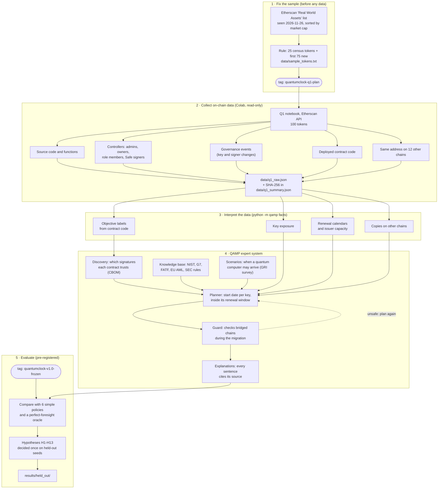

# The experiment at a glance

QAMP plans when the keys behind tokenised real-world assets should move to quantum-safe cryptography.
This page shows what was done, in what order, and where each output is in this folder.

## Steps and where to find them

| Step | What happens | Output |
|---|---|---|
| 1. Sample | 100 tokens chosen by a fixed rule and recorded before any data were collected | `data/sample_tokens.txt`, `data/etherscan_rwa_snapshot_2026-11-26.txt` |
| 2. Collection | The Colab notebook reads each token from Etherscan. It only reads; it writes nothing on-chain | `notebooks/Q1_fetch_anchor_facts.ipynb`, `data/q1_raw.json`, `data/q1_summary.json` |
| 3. Interpretation | Raw data become model inputs: exposed keys, renewal calendars, capacity, chain copies, labels | `data/anchor_facts.json`, `data/labels_bytecode.csv`, `results/observed/` |
| 4. Expert system | Inventory, rules, scenarios, planning, bridge check, cited explanations | `src/qamp/`, `kb/` |
| 5. Evaluation | QAMP against simple policies; hypotheses decided once on unseen seeds | `results/held_out/` (after freezing) |

## Order of events (git tags)

| Tag | Meaning |
|---|---|
| `quantumclock-v0.1.1` | First prototype on the 25-token census |
| `quantumclock-v0.2.1` | On-chain data collection and explanation checks added |
| `quantumclock-q1-plan` | 100-token sample fixed, before any data were collected |
| `quantumclock-v1.0-frozen` | Code and hypotheses frozen, before the held-out run (planned) |

Data source: Etherscan.io (label list and API).
