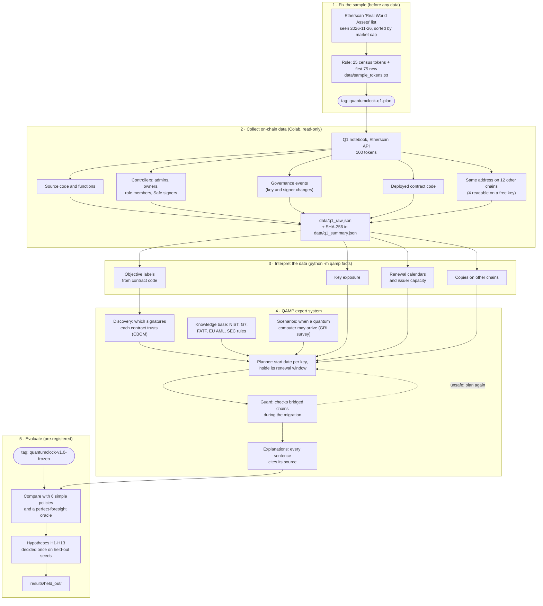

# The experiment at a glance

QAMP plans when the keys behind tokenised real-world assets should move to quantum-safe cryptography.
This page shows what was done, in what order, and where each output is in this folder.
A page for each step, with dates, fingerprints, checks and deviations, is in [steps/](steps/README.md).

## Progress: what worked and what failed

Each box is a milestone. Green: worked as planned. Red: failed or was refuted. Amber: a fix made in the open after
a failure. Grey: still to come. Details for each step: [1](steps/01_sample.md), [2](steps/02_collection.md),
[3](steps/03_facts.md), [4](steps/04_dev_real.md), [5](steps/05_q1b.md), [6](steps/06_rq1.md), [7](steps/07_held_out.md), [8](steps/08_ai_runs.md), [9](steps/09_manuscript.md), [10](steps/10_post_hoc_checks.md). Background on Safe multisig wallets:
[SAFE.md](SAFE.md).

```mermaid
flowchart TD
    classDef ok fill:#d8f0d8,stroke:#2e7d32,color:#1b3d1b
    classDef bad fill:#f8d7d7,stroke:#c62828,color:#4a1010
    classDef fix fill:#fde9c8,stroke:#e08a00,color:#4a3000
    classDef todo fill:#eeeeee,stroke:#9e9e9e,color:#555555

    P1["v0.1-v0.2 · Prototype on 25-token census<br/>assumed calendars"]:::ok
    R0["Census results: QAMP not better than ASAP (H1 refuted)<br/>timing pays only with long renewals (H11)"]:::bad
    S1["Step 1 · Sample of 100 tokens fixed<br/>before any data"]:::ok
    F1["First page save empty<br/>(table loaded by JavaScript)"]:::bad
    X1["Saved again as single file"]:::fix
    S2["Step 2 · Q1 collection<br/>100 tokens, 20,234 events, digest checked"]:::ok
    F2["8 chains unreadable on a free key<br/>Linea limit hit for 24 tokens"]:::bad
    S3["Step 3 · Facts: 135 anchors<br/>issuers named Apple, Amazon..."]:::bad
    X3["v0.3.1 · group by any shared controller<br/>one anchor per shared beacon → 92 anchors"]:::fix
    O3["Finding: key changes are frequent<br/>and bursty, not yearly"]:::ok
    S4["Step 4 · v0.3.1 run on real data<br/>no feasible plan, scored as 'no migration'"]:::bad
    X4["v0.3.2 · soft 2035 deadline, diagnosis,<br/>never score a failed plan"]:::fix
    O4["With Q1 data only: Backed cannot meet 2035<br/>(42 slots needed, 36 left); price ≈ $299M"]:::ok
    U4["Headline depends on one unknown:<br/>are Backed's role keys shared?"]:::bad
    S5["Step 5 · Q1b top-up: Backed role holders<br/>plan tagged before fetching"]:::ok
    O5["All 20 Backed tokens share 3 role holders<br/>92 → 75 anchors, no issuer overloaded"]:::ok
    R5["QAMP about 10% cheaper than ASAP<br/>H1, H3, H7, H8 now confirmed"]:::ok
    K5["Still refuted: H2, H4, H5<br/>(QAMP closes 32% of gap to oracle, not half)"]:::bad
    E5["Mint and burn keys are single wallets<br/>with exposed public keys"]:::ok
    L6["Step 6 · RQ1 labels: 800 from bytecode,<br/>192 read from source (fixed before scoring)"]:::ok
    H9["H9 refuted: discovery recall 0.852 < 0.90<br/>forwarder, ECDSA, compliance rules too crude"]:::bad
    S6["Step 7 · Decisions D1-D20 recorded<br/>tag: quantumclock-v1.0-frozen"]:::ok
    S7["Held-out run, once (seeds 50,000)"]:::ok
    F1["Confirmed: H1, H2b, H3, H6, H7, H8, H11, H12<br/>QAMP $369.6M vs ASAP $409.2M"]:::ok
    F2["Refuted: H2, H4, H5, H9<br/>(pessimism not best; a third of oracle gap)"]:::bad
    A8["Step 8 · AI runs on frozen code<br/>(model with temperature 0; retry when busy)"]:::ok
    F4["H10 refuted: AI F1 0.16 vs rules 0.75<br/>85/100 answers cut off at 2,000 tokens"]:::bad
    F5["H13 refuted: 55% of AI rewording verifiable<br/>(numbers rephrased; templates 100%)"]:::bad
    M9["Step 9 · Manuscript v2 compiles on Overleaf<br/>named + review copy; per-issuer appendix"]:::ok
    L9["Overleaf: table too wide, empty pages,<br/>appendix tables misplaced"]:::bad
    X9["Layout and wording fixed<br/>('two-stage' removed; p-values explained)"]:::fix
    P10["Step 10 · Checks after the run (not pre-registered)<br/>loss settings, H6 guard, knowledge-base scenarios"]:::ok
    O10a["QAMP cheaper than ASAP, greedy and Mosca<br/>in all 14 loss settings"]:::ok
    L10a["H6 measured unlike for like (47.0%)<br/>guard fails when copies run late on their own"]:::bad
    X10a["Pre-registration corrections C1-C3<br/>like for like 23.7%: H6 kept, scope stated"]:::fix
    O10b["Scenario plan committed first; deadline rules<br/>steer the plan; Ondo shown infeasible (22 vs 16)"]:::ok
    L10b["Retention rules barely move the plan;<br/>checks miss a wrong source name (43 sentences)"]:::bad
    F3["Next · author details, own papers,<br/>submission"]:::todo

    P1 --> R0 --> S1
    S1 --> F1 --> X1 --> S2
    S2 --> F2
    S2 --> S3 --> X3 --> O3 --> S4
    S4 --> X4 --> O4
    X4 --> U4 --> S5 --> O5 --> R5 --> L6 --> H9 --> S6 --> S7
    S7 --> F1
    S7 --> F2
    S7 --> A8
    A8 --> F4
    A8 --> F5
    F4 --> M9
    F5 --> M9
    M9 --> L9 --> X9 --> P10
    P10 --> O10a
    P10 --> L10a --> X10a
    P10 --> O10b
    P10 --> L10b
    O10a & X10a & O10b & L10b --> F3
    O5 --> E5
    R5 --> K5
```

### Hypotheses: from development to the final verdict

| | Census, assumed calendars | Real data (step 4) | Real data with Q1b (step 5) | **Held-out run (final)** |
|---|---|---|---|---|
| Confirmed | H4, H6, H7, H11, H12 | H2, H2b, H6, H11, H12 | H1, H2b, H3, H6, H7, H8, H11, H12 | **H1, H2b, H3, H6, H7, H8, H11, H12** |
| Refuted | H1, H2, H3, H5, H8 | H1, H3, H4, H5, H7, H8 | H2, H4, H5, H9 | **H2, H4, H5, H9, H10, H13** |
| Inconclusive | H2b | – | – | – |
| Pending | H9, H10, H13 | H9, H10, H13 | H10, H13 | **none** |

Only the last column is evidence; the others are development runs. Final count: **8 confirmed, 6 refuted** (H10 and
H13 from the AI runs, step 8). Held in every setting: H6, H11, H12. Refuted in
every setting: H5. The held-out verdicts match the last development column exactly, and the sensitivity run agrees
on every hypothesis.

## Steps and where to find them

| Step | What happens | Output |
|---|---|---|
| 1. Sample | 100 tokens chosen by a fixed rule and recorded before any data were collected | `data/sample_tokens.txt`, `data/etherscan_rwa_snapshot_2026-11-26.txt` |
| 2. Collection | The Colab notebook reads each token from Etherscan. It only reads; it writes nothing on-chain | `notebooks/Q1_fetch_anchor_facts.ipynb`, `data/q1_raw.json`, `data/q1_summary.json` |
| 3. Interpretation | Raw data become model inputs: exposed keys, renewal calendars, capacity, chain copies, labels | `data/anchor_facts.json`, `data/labels_bytecode.csv`, `results/observed/` |
| 4. Expert system | Inventory, rules, scenarios, planning, bridge check, cited explanations | `src/qamp/`, `kb/` |
| 5. Evaluation | QAMP against simple policies; hypotheses decided once on unseen seeds | `results/held_out/` (after freezing) |

## Order of events (git tags)

| Tag | Meaning |
|---|---|
| `quantumclock-v0.1.1` | First prototype on the 25-token census |
| `quantumclock-v0.2.1` | On-chain data collection and explanation checks added |
| `quantumclock-q1-plan` | 100-token sample fixed, before any data were collected |
| `quantumclock-v0.3-data` | Q1 data collected (block 26496449) |
| `quantumclock-v0.3.1` | Facts from real data; issuer grouping and shared-beacon fixes |
| `quantumclock-v0.3.2` | Soft deadline with diagnosis; development runs on real data |
| `quantumclock-q1b-plan` | Q1b top-up rule fixed, before any Q1b data were collected |
| `quantumclock-v0.3.4` | Q1b data, facts and development runs with Backed's real role holders |
| `quantumclock-v0.3.7` | RQ1 labels committed, discovery scored (H9 refuted) |
| `quantumclock-v1.0-frozen` | Decisions D1-D20 recorded; code, data and hypotheses frozen (`cb1c560`) |
| `quantumclock-v1.0-results` | Held-out results committed unchanged |
| `quantumclock-v1.0-ai` | AI runs (H10, H13) on the frozen code |

Data source: Etherscan.io (label list and API).
