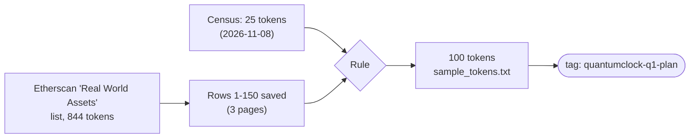

# Step 1: Fix the sample

| | |
|---|---|
| Date | 2026-11-26 (pages saved 10:20-10:21 AWST, UTC+08:00) |
| Commit | `24a7873` |
| Tag | `quantumclock-q1-plan` |
| Status | done, before any data were collected |

## Why

The tokens studied must be chosen by a fixed rule and recorded before any data are collected, so the choice
cannot be influenced by the results.

## Rule

The 25 tokens of the earlier census (rwa-threatlab, seen 2026-11-08), plus the first 75 other tokens in the order
shown on Etherscan's "Real World Assets" token list, sorted by market cap. No exclusions, no replacements.

## What was done

1. Opened the list sorted by market cap, 50 rows per page:
   `https://etherscan.io/tokens/label/real-world-assets?subcatid=0&size=50&start=0&col=3&order=desc`
   (pages 2 and 3 through the page buttons).
2. Saved pages 1-3 (rows 1-150) in Chrome as "Webpage, Single File".
3. Ran `python tools/build_sample.py page1.mhtml page2.mhtml page3.mhtml`.
4. Committed the two output files and the script, then tagged the commit.

## Inputs and outputs

| File | SHA-256 |
|---|---|
| Saved page 1 (rows 1-50), kept by the author | `a09a1c7833c3b8785b4a73f00ab31a68e5a1885b766df1d38753f0ffc5c52ed1` |
| Saved page 2 (rows 51-100), kept by the author | `34b6d35cb24b1b6b144c39766a5c31c6f9f9b8f18afcbada214d8509c59dd271` |
| Saved page 3 (rows 101-150), kept by the author | `7c7fd5fc2ce89e6ac8a35a221978f6bc1be0a6260b0f80e2041981348925132d` |
| `data/sample_tokens.txt` (100 tokens) | `2920886a1f6e676c6f0eee750d5a38b54e804bdb374144c6b38e0f76a1afee8f` |
| `data/etherscan_rwa_snapshot_2026-11-26.txt` (all 150 rows) | `281e17fa8e6120d6711b0c87e2be045ba951568f64b6257699cf10eb31e63501` |
| `tools/build_sample.py` | `c9bb85fa986cccea394475ce57955c822aea90e5aefa076c14a362b2cafdf3e5` |

## Checks

| Check | Result |
|---|---|
| Rows read | 150, all different (no token on two pages) |
| Census tokens found in the list | 25 of 25, all within rows 1-28 |
| Tokens in the sample | 100: exactly that day's rows 1-100 |
| Software tests on the committed repository | 39 passed |
| Sample committed and tagged before the collection started | yes (tag at 10:35; collection started after) |

## Deviations from the plan

1. **First save failed.** The pages were first saved as "Webpage, HTML Only". Those files contained no table rows,
   because Etherscan loads the table with JavaScript after the page opens. The pages were saved again as
   "Webpage, Single File", which keeps what is shown on screen. Only the second set was used.
2. **The list grew.** Etherscan listed 844 tokens on 2026-11-26, against 841 on 2026-11-08. The rule does not depend
   on the total.
3. **Rule changed before use.** The first draft rule was "append rows 26-100". Because the ranking had moved since
   2026-11-08, it was replaced, before any data were collected, by "the 25 census tokens plus the first 75 others", so
   that no token could be counted twice or missed. The draft rule would in fact have done both: one census token had
   moved to row 28 (counted twice), and the token in row 25 would have been left out.
