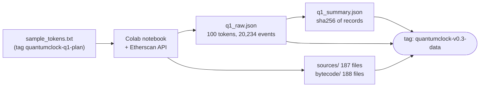

# Step 2: Collect on-chain data

| | |
|---|---|
| Date | 2026-11-26, about 10:45-12:19 AWST (UTC+08:00) |
| Block | 26496449 (Ethereum mainnet) |
| Commits | data `8f7e704`, `967cb30`, `c006ea1`, `3cae1c2`, `3f3e00d`; run evidence `485626a` |
| Tag | `quantumclock-v0.3-data` |
| Status | done |

## Why

QAMP's plans should rest on what token contracts really show (who controls them, how often keys change, where
copies exist), not on assumptions. This step collects that raw material once, for the fixed sample of step 1.
It only collects; step 3 interprets.

## What was done

1. Opened `notebooks/Q1_fetch_anchor_facts.ipynb` in Google Colab at tag `quantumclock-q1-plan` (commit `24a7873`),
   so the token list could not change.
2. Ran it with a new free Etherscan key, typed into a hidden prompt. The key is not in any file and was deleted on
   etherscan.io after the run.
3. For each of the 100 tokens the notebook read: verified source code, proxy slots, owner and default admin, role
   members, controllers (multisig owners and threshold, timelock delay), governance events, contract bytecode, and
   whether the same address holds a token on 12 other chains.
4. The notebook wrote `q1_raw.json`, a summary with the SHA-256 of the records, and the source and bytecode files.
   These were committed in five uploads (GitHub accepts at most 100 files per upload).
5. The executed notebook and three screenshots of the run were committed to `notebooks/runs/`.

## Inputs and outputs

| File | SHA-256 |
|---|---|
| `data/sample_tokens.txt` (input, from step 1) | `2920886a1f6e676c6f0eee750d5a38b54e804bdb374144c6b38e0f76a1afee8f` |
| `data/q1_raw.json` (file) | `d068641ce416baa018491af57cad26c8c2633741a7414e93f0ffe2d9b0bc253f` |
| Records inside `q1_raw.json` (`sha256_raw`, as computed by `qamp.extraction.digest`) | `22354c353f56f7c01ecdf0d995df38d9df6ccc04530f1a3fa9ed3ec24d1e6728` |
| `data/q1_summary.json` | `7c9258051b809f14c87ce5c7d4084f03a9effe6bdad919fa4dd52211b021d97e` |
| `notebooks/runs/Q1_fetch_anchor_facts.ipynb` (executed copy) | `a484db471fd454d6e4aaaf75a3a98f91b6261022448c82ea97892cc8e699f5e7` |
| `data/sources/` | 187 verified source files |
| `data/bytecode/` | 188 bytecode files |

## What came back

| Item | Count |
|---|---|
| Tokens | 100 of 100 |
| Verified source code | 99 |
| Proxies | 88 |
| Distinct controllers seen | 102 |
| Governance events | 20,234 |
| Tokens with a copy on Arbitrum / Mantle / Polygon | 26 / 20 / 2 |

## Checks

| Check | Result |
|---|---|
| `sha256_raw` in the summary matches the records | yes |
| All 377 data files on GitHub identical to the notebook output | yes, byte for byte |
| Executed notebook on GitHub identical to the downloaded copy | yes |
| API key absent from the notebook, data and screenshots | yes (the prompt shows dots only) |
| Screenshots free of names, bookmarks and profile pictures | yes |

## Errors (expected and unexpected)

Every token has 8 or 9 recorded errors. None concerns Ethereum itself.

| Chain(s) | Tokens | Reason |
|---|---|---|
| Optimism, BNB, Base, Avalanche, Gnosis | 100 | Not readable with a free key |
| Scroll, Blast, zkSync | 100 | Not supported by Etherscan API V2 |
| Linea | 24 (tokens 59-96, scattered) | Free daily limit for Linea reached during the run |

## Deviations from the plan

1. **Fewer chains than planned.** 12 other chains were planned; only Polygon, Arbitrum, Mantle and Linea could be read
   with a free key. Copies on the other 8 chains are unknown, so the observed bridges are a lower bound.
2. **Linea partly missed.** 24 tokens were not checked on Linea. The 76 tokens that were checked had no Linea copy, so
   the gap probably hides nothing. The data were not fetched again, because that would change the frozen records.
3. **Runtime timed out after the run.** Colab disconnected for inactivity after the run had finished and the zip had
   downloaded. No data were lost.
