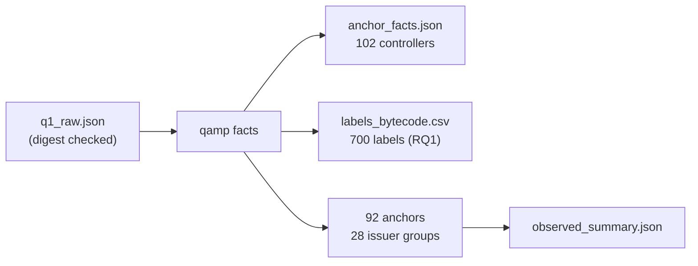

# Step 3: Interpret the data

| | |
|---|---|
| Date | 2026-11-27 |
| Commits | fix `e447f72` (v0.3.1); outputs `2322e89` |
| Command | `python -m qamp facts` |
| Status | done |

## Why

The raw records say who controls each token. QAMP needs trust anchors: one per key that can change a token, with
its issuer, renewal calendar, change capacity and copies on other chains. This step turns records into anchors.

## What was done

1. Ran `python -m qamp facts` with the code fixed before the data (v0.2.1) on the committed data. It checks the digest first.
2. Inspected the result. Two rules gave wrong anchors (see deviations). Fixed both in v0.3.1 and added a test.
3. Ran the command again from a fresh copy of the GitHub repository. All 40 tests passed and the outputs were
   identical to the local run.

## Inputs and outputs

| File | SHA-256 |
|---|---|
| Records in `data/q1_raw.json` (input) | `22354c353f56f7c01ecdf0d995df38d9df6ccc04530f1a3fa9ed3ec24d1e6728` |
| `data/anchor_facts.json` | `97af0d417b074d8a5f2c39811e78bff2e278a1edce72a90721a8336352d5c0c1` |
| `data/labels_bytecode.csv` | `1124c2adecdd8fe391b884e04132de892c6f6d221e19f6f14baaae174bc2a0cb` |
| `results/observed/observed_summary.json` | `3f9ceb723c54cc4cf22e8ac613f541ee7b101500ba7800b5aabfe0564aa7ed61` |

## What the data show

| Item | Result |
|---|---|
| Trust anchors | 92 (24 upgrade admins, 9 owners or admins, 59 role holders) |
| Issuer groups | 28; largest: Ondo (46 tokens), Backed (20), Midas (3) |
| Controller types | 8 multisig, 5 EOA, 4 timelock, 5 other contract, 19 not readable, 51 role holders not listable |
| Public key exposed (of 102 controllers) | 38 yes (28 EOAs that have sent a transaction, 10 contracts whose signers have), 7 no, 57 unknown (contracts whose signers could not be traced) |
| Calendars measured from key changes | 25 anchors: 23 change about every quarter, 2 about every 3 quarters |
| Calendars still assumed (yearly) | 67 anchors (fewer than 3 key-change days seen) |
| Most keys changed in one quarter (capacity) | Ondo 4, Re 2, all others 1 |
| Anchors with copies on other chains | 30 (Arbitrum 30, Mantle 21, Polygon 1) |
| Automatic labels for RQ1 | 700 (100 tokens x 7 bytecode surfaces) |

**The key finding of this step:** where key changes can be measured, they are frequent and bursty, not yearly. This
is the setting in which the development runs found timing-aware planning helps least (H11 holds for long renewal
periods). It will be tested, not adjusted.

## Checks

| Check | Result |
|---|---|
| Digest of the records before use | matches |
| Issuer groups mix no issuers (checked by hand, by name and symbol) | yes |
| Tests (v0.3.1, fresh copy of GitHub) | 40 passed |
| Outputs from GitHub copy identical to local run | yes |

## Deviations from the plan

Both rules below were fixed at tag `quantumclock-q1-plan`, before the data. They were changed after seeing the data,
because they produced anchors that were plainly wrong. Both changes are in v0.3.1 and will be listed in the
pre-registration.

1. **Issuer grouping.** The old rule merged tokens only if they shared an upgrade admin, owner or default admin. Ondo
   links its tokens through role holders, so its 44 tokenised stocks fell back to the name rule and became "issuers"
   called Apple, Amazon, iShares and so on (54 groups). The new rule merges tokens that share any observed controller,
   and names each group after its largest token. Result: 28 groups.
2. **Shared beacon.** The 44 Ondo stock tokens are beacon proxies with the same implementation, so one key upgrades
   all of them. The old rule made a separate unreadable anchor for each token (44 anchors). The new rule makes one
   anchor per shared beacon. Anchors fell from 135 to 92.
3. **Calendars not changed.** The calendar rule (at least 3 change days; median gap, clipped to 1-8 quarters) was kept
   as fixed, although it turns bursts of changes into a 1-quarter period. A sensitivity check is planned instead.

## Limitations noted

- 51 role-holder anchors could not be listed (for example, Backed sets roles through its own functions, not
  AccessControl). They keep the default assumptions.
- 19 upgrade admins are not readable (mostly UUPS proxies, where the right to upgrade sits in the implementation).
- The beacon's owner was not read, so the shared Ondo upgrade key is counted but its holder is unknown.
