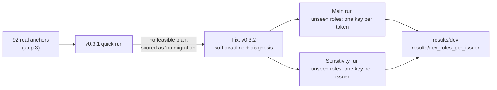

# Step 4: Development runs on real data

| | |
|---|---|
| Date | 2026-11-27 |
| Commits | planner fix `98d56b2` (v0.3.2); results `08951af` |
| Commands | `python -m qamp experiments` and `python -m qamp --unobserved-roles per_issuer experiments` |
| Seeds | development (base 0). **Not evidence**: the held-out seeds (base 50,000) are still unused. |
| Status | done |

## Why

Before freezing the system, run every experiment once on the real anchors of step 3, to find faults while they can
still be fixed openly. The pre-registered results come later, from the held-out seeds.

## What was done

1. Ran the experiments at v0.3.1 (quick settings). QAMP, its variants and the oracle all scored the same cost as
   "no migration". Found the cause (below) and fixed it in v0.3.2.
2. Ran the full development set at v0.3.2, then the sensitivity run, both from a fresh copy of the GitHub repository.
   Both gave the same numbers as the local runs.

## The fault found

Backed has 21 anchors. Each takes 2 quarters to migrate, and the data show Backed changing at most one key per
quarter. That needs 42 quarters; 36 remain before the 2035 deadline. No schedule can fit, so the planner (which
treated 2035 as a hard limit) found no plan. The code then scored the missing plan as "no migration" without warning.

**Fix (v0.3.2).**
- The deadline is now soft. The planner first minimises the number of anchors that miss 2035, then the expected
  cost ("compliance first"). An anchor that cannot fit is scheduled in the last quarter and counted as a miss, which
  is what the list baselines already did.
- When an issuer cannot finish in time, the plan says so: "Backed needs 42 quarter-slots; capacity 1 over 36
  quarters gives 36."
- A plan with an anchor left out now stops the run with an error.
- A "cost first" mode (expected cost first, then misses) was added as an ablation.

## Inputs and outputs

| File | SHA-256 |
|---|---|
| `results/dev/results.json` | `272ebe678fc1024dc7d68faaded602a7540dd8d37f8ed063cbcf9f0ac3a22605` |
| `results/dev/hypotheses.md` | `0d96e2b84801bafa64c4aed32015c2483d2c23e29d5836843dd5590f448d53c8` |
| `results/dev/main_table.md` | `9f8bf2f8a58e19a9705d1fd8ee1ec87ac0c6c83e68b4a86e80a5311a0ea67307` |
| `results/dev_roles_per_issuer/results.json` | `f6eab020a0bec8aa99d5f35a21046af835fc61e0251851ef1dc5ebd755eea7a0` |
| `results/dev_roles_per_issuer/hypotheses.md` | `a659e0ee1ee4157f23441ab6b41da1ff79a6d26cdf73c4d8a3a47d4f80f44eb1` |
| `results/dev_roles_per_issuer/main_table.md` | `c3ae7de5782ada2dcfe61e0947acaee921b44fe0b1d2b79f7c13a3b4b81c2f5b` |

## Results

Mean realised cost over 2,000 development scenarios, and mean number of anchors that miss 2035.

| Policy | Main run: cost | Main run: misses | Sensitivity: cost | Sensitivity: misses |
|---|---|---|---|---|
| QAMP, compliance first (default) | $794.0M | 3.6 | $379.3M | 0 |
| QAMP, cost first | $495.4M | 4.3 | $379.3M | 0 |
| QAMP without decision windows | $521.6M | 4.3 | $385.0M | 0 |
| ASAP | $531.9M | 4.3 | $431.8M | 0 |
| Greedy risk | $522.2M | 4.3 | $419.4M | 0 |
| Annual review | $749.2M | 12.3 | $577.7M | 0 |

**Price of compliance (main run):** QAMP's default spends $298.6M more expected loss than its cost-first mode to
avoid 0.70 deadline misses (about $426M per avoided miss). In the sensitivity run there is no conflict, so it is $0.

### Hypotheses (development outcomes only)

| ID | Census, assumed calendars (v0.2.1) | Real data, main run | Real data, sensitivity |
|---|---|---|---|
| H1 QAMP beats every list baseline | refuted | refuted | **confirmed** |
| H2 pessimistic beats stochastic | refuted | confirmed | refuted |
| H2b pessimistic beats expected | inconclusive | confirmed | confirmed |
| H3 decision windows matter | refuted | refuted | **confirmed** |
| H4 no gain with quarterly renewals | confirmed | refuted | refuted |
| H5 closes half the gap to the oracle | refuted | refuted | refuted |
| H6 guard prevents mixed-state violations | confirmed | confirmed | confirmed |
| H7 guarded cheaper than independent | confirmed | refuted | refuted |
| H8 H1 holds two years earlier | refuted | refuted | **confirmed** |
| H11 timing pays: 8-quarter renewals, capacity 1 | confirmed | confirmed | confirmed |
| H12 rationales faithful | confirmed | confirmed | confirmed |
| H9, H10, H13 | pending | pending | pending |

## What this means

1. **One unknown decides the headline.** Whether QAMP beats the baselines (H1, H3, H8) depends on whether Backed's
   unreadable role holders are one key per token or one shared key. Backed's verified source has public getters
   (`minter()`, `burner()`, `pauser()`, `multiplierUpdater()`), so this can be read from the chain. A small top-up
   collection (step 5) will do it.
2. **When a deadline cannot be met, the expert system says so** and prices the choice between meeting more deadlines
   and lowering expected loss. The baselines do neither.
3. **Robust results.** H6, H11 and H12 hold in all three columns.
4. **Results that changed with real data.** H4 and H7 held on the census but not on real data. Both will be reported.

## Checks

| Check | Result |
|---|---|
| Tests (v0.3.2, fresh copy of GitHub) | 42 passed |
| Results from GitHub copy identical to local run | yes, both runs |
| Every plan has a start for every anchor | yes (enforced by the new check) |
| Held-out seeds used | no |

## Deviations from the plan

1. **Planner changed after seeing real data** (hard deadline → soft deadline, compliance first). The original design
   could not produce a plan for an overloaded issuer. To be listed in the pre-registration.
2. **New ablation and metric** ("cost first" mode; price of compliance). Descriptive only; no new hypothesis.
3. **H5 is not well defined in the main run.** The oracle also puts the deadline first, so it can cost more than
   plans that ignore the deadline. To be settled before the freeze: either an oracle per mode, or H5 reported only
   where no issuer is overloaded.
4. **New sensitivity setting** (`--unobserved-roles per_issuer`), because the data cannot tell the two cases apart.
