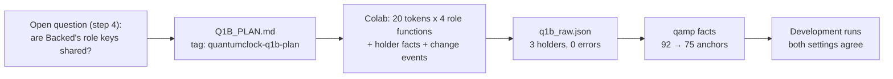

# Step 5: Top-up collection (Q1b): Backed role holders

| | |
|---|---|
| Date | 2026-11-27 (run at 11:49 AWST, UTC+08:00) |
| Block | 26503940 (Ethereum mainnet) |
| Commits | plan `be1c0c9` (v0.3.3); data `de759dc`; run evidence `a1fbee1`; facts and runs `86d4ee3` (v0.3.4) |
| Tags | `quantumclock-q1b-plan` (set before fetching) |
| Seeds | development (base 0). **Not evidence.** |
| Status | done |

## Why

Step 4 left one question open, and the headline result depended on it: does Backed use one set of role keys for all
its 20 tokens, or a separate set per token? Q1 could not see this, because Backed keeps its role holders in simple
functions such as `minter()`, not in the standard role list. Backed's verified source showed those functions are
public, so they could be read.

## What was done

1. Wrote the rule first ([Q1B_PLAN.md](../Q1B_PLAN.md)): which tokens, which 7 functions, what else to read, and how
   the data would be used. Committed and tagged `quantumclock-q1b-plan` before any data were fetched.
2. Ran `notebooks/Q1b_fetch_role_getters.ipynb` in Colab at that tag, with a free Etherscan key typed into a hidden
   prompt. The key was deleted afterwards.
3. Committed the data, the executed notebook and two screenshots.
4. Rebuilt the facts and re-ran both development sets from a fresh copy of the GitHub repository.

## Inputs and outputs

| File | SHA-256 |
|---|---|
| Records in `data/q1b_raw.json` (`sha256_raw`) | `c7214317929e9db9f8d709c531b8bab2248305c3b7cc681212033ce7f3f9a581` |
| `data/q1b_raw.json` (file) | `4a958236b92ed9532a2da8d39308fc3556b6a260d16eedad19d049597c8031ef` |
| `data/q1b_summary.json` | `1aecb03f97cc598e6d31c8c0fee504df56f05947a5bcd3e4b61c94f562e1cad4` |
| `notebooks/runs/Q1b_run_2026-11-27.ipynb` | `acf6837e1b988c3128351fb8e55ca0fa3fa5720fd2f71c75731b8a69070a7447` |
| `data/anchor_facts.json` (rebuilt) | `9ccd7519d5e01fd068cabf5b1316f528d21516fb7f07d05bd88506b9f7061362` |
| `results/observed/observed_summary.json` | `ab1f63d10f6cd5e715faa7b7e805a73111ec65344efc45da414c5b87511537b4` |
| `results/dev/results.json` | `2c08ee4fd6a215c7632a5fba2356b529c04a9fdd4acb24fc69abbe0f06237881` |
| `results/dev_roles_per_issuer/results.json` | `e1f2868a97990687196e76dfce1b097521dfb4cd835605e6669181a5bf47003e` |

## What came back

**All 20 Backed tokens have the same role holders. Backed shares one set of keys.**

| Role | Holder | Kind | Transactions sent (key exposed) |
|---|---|---|---|
| minter | `0x0a934b…` | single wallet | 4,477 |
| burner | `0x5f7a4c…` | single wallet | 40,785 |
| multiplierUpdater | `0x5f7a4c…` (same as burner) | single wallet | 40,785 |
| pauser | `0x8768cd…` | Safe multisig, 2 of 4 | – (3 of its 4 owners exposed, one is the burner wallet) |

Each token returned 14 events (role changes on the token and owner changes on the Safe), which give real change dates for these keys. There were 0 errors.
Background on Safe wallets and what the data show about them: [SAFE.md](../SAFE.md).

## Effect on the model

| | Before Q1b (step 4) | With Q1b |
|---|---|---|
| Trust anchors | 92 | 75 (Backed: 21 → 4 real keys) |
| Measured calendars | 25 | 28 |
| Backed's capacity (most keys changed in one quarter) | 1 | 4 |
| Issuers that cannot meet 2035 | Backed | none |
| Anchors with copies on other chains | 30 | 13 (Backed's copies now sit on 4 shared anchors) |

## Results (development seeds, 2,000 scenarios)

| Policy | Main run: cost | Sensitivity (hidden roles shared per issuer): cost |
|---|---|---|
| QAMP (compliance first) | **$391.7M** | **$371.8M** |
| QAMP, cost first | $391.9M | $371.9M |
| QAMP without decision windows | $423.3M | $401.2M |
| ASAP | $434.4M | $418.6M |
| Greedy risk | $425.1M | $407.7M |
| Mosca rule | $428.2M | $411.7M |
| Annual review | $573.3M | $557.0M |
| Perfect foresight (oracle) | $299.7M | $277.9M |

No policy misses the 2035 deadline in either run, so the price of compliance is zero: both QAMP modes give the
same plan, up to solver rounding.

### Hypotheses: how the development outcomes moved

| ID | Census (v0.2.1) | Real data, step 4 | **Real data with Q1b** |
|---|---|---|---|
| H1 QAMP beats every list baseline | refuted | refuted | **confirmed** |
| H2 pessimistic beats stochastic | refuted | confirmed | refuted |
| H2b pessimistic beats expected | inconclusive | confirmed | confirmed |
| H3 decision windows matter | refuted | refuted | **confirmed** |
| H4 no gain with quarterly renewals | confirmed | refuted | refuted |
| H5 closes half the gap to the oracle | refuted | refuted | refuted (32%) |
| H6 guard prevents mixed-state violations | confirmed | confirmed | confirmed |
| H7 guarded cheaper than independent | confirmed | refuted | **confirmed** |
| H8 H1 holds two years earlier | refuted | refuted | **confirmed** |
| H11 timing pays: 8-quarter renewals, capacity 1 | confirmed | confirmed | confirmed |
| H12 rationales faithful | confirmed | confirmed | confirmed |
| H9, H10, H13 | pending | pending | pending |

The main run and the sensitivity run now give the same verdict on every hypothesis.

## Checks

| Check | Result |
|---|---|
| Plan tagged before the data were fetched | yes (`quantumclock-q1b-plan`, 11:38 AWST; run 11:49) |
| Digest of the Q1b records | matches |
| Q1 records and their digest unchanged | yes (Q1b is added on loading) |
| API key absent from data, notebook and screenshots | yes |
| Tests (v0.3.4, fresh copy of GitHub) | 44 passed |
| Results from GitHub copy identical to local run | yes |

## Deviations and notes

1. **v0.3.4 changed comments only, plus one line of output.** When no deadline can be missed, the results now say
   "price of compliance: none" instead of printing a tiny negative number (solver rounding). No result changed.
2. **The step-4 failure stays in the record.** With what Q1 could see, the expert system correctly reported that
   Backed could not meet 2035. Q1b then showed the role keys are shared, so the conflict was a gap in the data, not in
   the market. Both findings are reported.
3. **Still pending:** RQ1 hand labels, the LLM runs (H10, H13), the pre-registration decisions (including how H5 is
   defined when an issuer is overloaded), the freeze, and the held-out run.
