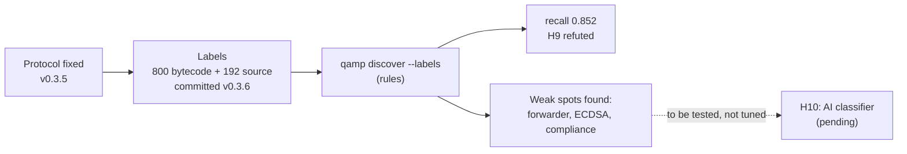

# Step 6: RQ1: does QAMP find where tokens trust signatures?

| | |
|---|---|
| Date | 2026-11-27 |
| Commits | protocol `c379ad0` (v0.3.5); labels `7ce34cc` (v0.3.6); scoring and runs (v0.3.7) |
| Command | `python -m qamp discover --source-dir data/sources --labels data/labels.csv` |
| Status | done (H9 decided; H10 waits for the AI run) |

## Why

The planner is only as good as its inventory. RQ1 asks whether QAMP's discovery finds every place a token's code
trusts a signature or a key ("surface"). H9 (fixed in advance): rules-based discovery reaches **recall ≥ 0.90**
against the labels.

## What was done

1. **Protocol changed before any hand label was made** (v0.3.5, [LABELLING.md](../LABELLING.md)):
   `ownable_admin` moved to bytecode; the three controller surfaces are not scored (circular); one label per
   distinct source code (100 tokens → 32 codes), copied to identical tokens.
2. **Labels made** (v0.3.6): 800 from bytecode, 192 by reading source (6 surfaces × 32 codes, each positive with file
   and line), copied to 600 token rows. Committed **before** discovery was scored against them.
3. **Discovery scored** against the committed labels, per token and per distinct code (v0.3.7). H9 is now decided
   by code from the saved score.

## Inputs and outputs

| File | SHA-256 |
|---|---|
| `data/labels_A.csv` (192 source labels) | `f6685175fe80766a4aaa95698ba1a0ba41de97082208209c8d35a68a922fbdaf` |
| `data/labels.csv` (all 1,400 labels) | `0b04a137bed4516ea0649a8389aa4b71c0023e5a78ce0c45a0fffa0a29c8f94f` |
| `results/discovery/discovery_rules.json` | `1908051bfd7b1ed53eb6a4181e1a5d4edd2758f43813cd618d638bb76e640814` |

## Results (rules-based discovery)

| | Precision | Recall | F1 |
|---|---|---|---|
| Every token (384 labelled positives) | 0.670 | **0.852** | 0.750 |
| Each distinct code once | 0.649 | 0.865 | 0.741 |

**H9: REFUTED.** Recall 0.852 is below the 0.90 threshold.

| Surface | Found (TP) | Wrong (FP) | Missed (FN) | Precision | Recall |
|---|---|---|---|---|---|
| `access_control_roles` | 59 | 1 | 0 | 0.98 | 1.00 |
| `enumerable_roles` | 46 | 0 | 0 | 1.00 | 1.00 |
| `upgradeable_proxy` | 43 | 0 | 0 | 1.00 | 1.00 |
| `eip2612_permit` | 39 | 2 | 0 | 0.95 | 1.00 |
| `eip712_domain` | 39 | 2 | 0 | 0.95 | 1.00 |
| `ownable_admin` | 34 | 9 | 1 | 0.79 | 0.97 |
| `external_compliance_module` | 48 | 3 | 34 | 0.94 | **0.59** |
| `ecdsa_library` | 10 | 0 | 22 | 1.00 | **0.31** |
| `ecrecover_direct` | 5 | 32 | 0 | **0.14** | 1.00 |
| `erc2771_forwarder` | 4 | 89 | 0 | **0.04** | 1.00 |
| `signed_parameter_update` | 0 | 20 | 0 | 0.00 | – |
| `erc1271_contract_signature` | 0 | 3 | 0 | 0.00 | – |

## What this means

- **Strong where the code has a fixed signature:** roles, permit, typed data and proxies are found almost perfectly.
- **Three rules are too crude:**
  - the forwarder rule fires on almost every contract, because it matches a helper (`_msgSender`) that nearly all
    modern tokens have;
  - signature checks inside the standard ECDSA library are counted as "direct", and the upgradeable version of the
    library is missed;
  - outside compliance checks are found only when they use one of a few known names, so 41% are missed.
- **These rules will not be changed.** Tuning them on the labels would make RQ1 meaningless. They are the measured
  weakness that H10 tests: can the knowledge-grounded AI classifier do better?

## Checks

| Check | Result |
|---|---|
| Labels committed before scoring | yes (`7ce34cc`, then scored) |
| Discovery rules unchanged since the hypotheses were written (v0.2.1) | yes, except removing a model name from a default (no effect on rules) |
| Results from a fresh copy of GitHub | yes |
| Tests | 46 passed |

## Limits and deviations

1. **The source labels were made by an AI assistant**, at the author's request, not by a person. The same assistant
   drafted the discovery rules, so the labels are not independent of the system. Every positive label cites file and
   line, so anyone can check. A random 40-row sample (`data/labels_check_blank.csv`) is set aside for a blind human
   check; if done, its agreement is reported.
2. **One pass only**, so there is no agreement score between two labellers.
3. **Earlier peek:** while testing the scoring code (v0.3.5), discovery was run once against the bytecode labels only
   (recall 0.99, precision 0.71). No rule was changed after it.
