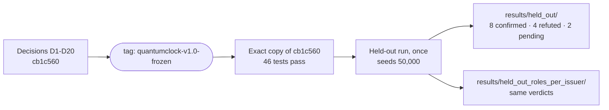

# Step 7: Freeze, then the held-out run

| | |
|---|---|
| Date | 2026-11-27 (run 13:14–13:15 UTC) |
| Frozen commit | `cb1c56096ee50d6c6f8dcdfde077a5098e4c60c9` (tag `quantumclock-v1.0-frozen`) |
| Results commit | `f101052` |
| Seeds | **held-out**, base 50,000 (used for the first and only time) |
| Commands | `python -m qamp experiments --held-out --frozen-commit cb1c560…` and the same with `--unobserved-roles per_issuer` |
| Status | done (H10, H13 wait for the AI runs) |

## Why

Everything before this step used development seeds and could be changed. This run is the evidence. Its value rests on
one fact: the code, data, labels and hypotheses were fixed (and the decisions recorded, D1–D20 in
[PREREGISTRATION.md](../PREREGISTRATION.md)) **before** these seeds were used.

## What was done

1. Recorded the author's decisions D1–D20 (commit `cb1c560`).
2. Tagged that commit `quantumclock-v1.0-frozen`.
3. Exported an exact copy of the frozen commit, ran the 46 tests (all passed), and ran the held-out set **once**: the
   main run and the pre-registered sensitivity run.
4. Committed the six output files unchanged.

## Outputs (committed unchanged)

| File | SHA-256 |
|---|---|
| `results/held_out/results.json` | `4454df594cefb06f06546bbc54d73800cecdc03e7eed4995af2e2a5e57aca672` |
| `results/held_out/hypotheses.md` | `47aa9875bcb0fa0cf7e7f4dc46da0843399c117425e9a0037b037c21b020d371` |
| `results/held_out/main_table.md` | `1d54793224a32c64d76c2e90ced76b623d38bc23c1728b9773509b904544b9a2` |
| `results/held_out_roles_per_issuer/results.json` | `304a867d68d44137abc29bd3626a41980b12148237c4892adeee3ee518b28e69` |
| `results/held_out_roles_per_issuer/hypotheses.md` | `379450ebdc6704c35282c4603e95ce7ed51ad8233c80452e0ad0a10b3cb534e2` |
| `results/held_out_roles_per_issuer/main_table.md` | `7316ed2e4e78824df8cc36ffb47c8dba5d7e2fa62bfbc1cbfe62c85d1221e761` |

## Results: main run (2,000 held-out scenarios)

| Policy | Expected cost | QAMP cheaper by | p (Holm) |
|---|---|---|---|
| **QAMP** | **$369.6M** | – | – |
| QAMP without the knowledge base | $369.6M | $0.0M | 1.0 (no difference) |
| QAMP, pessimistic margin | $383.2M | $13.6M | 0.0006 |
| QAMP without decision windows | $399.2M | $29.5M | 0.0006 |
| Greedy risk | $399.6M | $30.0M | 0.0006 |
| Mosca rule | $401.4M | $31.7M | 0.0006 |
| QAMP, expected (no delays) | $406.5M | $36.9M | 0.0006 |
| ASAP | $409.2M | $39.5M | 0.0006 |
| Readiness score (kg_score) | $501.4M | $131.8M | 0.0006 |
| Annual review | $531.0M | $161.4M | 0.0006 |
| Deadline-driven | $3,217.6M | $2,848.0M | 0.0006 |
| Perfect foresight (oracle, subset) | $320.6M | –$74.2M | – |

No policy misses the 2035 deadline, so the price of compliance is zero.

## Hypotheses: final verdicts

| ID | Verdict | Evidence (main run) | Sensitivity run |
|---|---|---|---|
| H1 QAMP beats every list baseline | **CONFIRMED** | cheaper than all 6, p_holm = 0.0006 | confirmed |
| H2 pessimistic beats stochastic | **REFUTED** | pessimistic costs $13.6M more | refuted |
| H2b pessimistic beats expected | **CONFIRMED** | $383.2M vs $406.5M | confirmed |
| H3 decision windows matter | **CONFIRMED** | ignoring them costs $29.5M | confirmed |
| H4 no gain with quarterly renewals | **REFUTED** | QAMP still 4.9% cheaper | refuted |
| H5 closes half the gap to the oracle | **REFUTED** | closes 33.6% | refuted (49.7%) |
| H6 guard prevents mixed-state violations | **CONFIRMED** | 13/13 without guard, 0 with | confirmed |
| H7 guarded cheaper than independent | **CONFIRMED** | $29.3M cheaper | confirmed |
| H8 H1 holds two years earlier | **CONFIRMED** | 6/6 baselines beaten | confirmed |
| H9 discovery recall ≥ 0.90 | **REFUTED** | 0.852 (decided in step 6) | – |
| H11 timing pays: 8-quarter renewals, capacity 1 | **CONFIRMED** | 11.1% cheaper than ASAP (formulated after the pilot) | confirmed |
| H12 rationales faithful | **CONFIRMED** | validity, faithfulness, consistency all 1.000 | confirmed |
| H10 AI classifier beats rules | pending | needs the AI run | – |
| H13 AI rewording keeps grounding | pending | needs the AI run | – |

**8 confirmed, 4 refuted, 2 pending** (corrected 2026-11-27: an earlier version of this page and the results commit message said 9). H10 and H13 were decided later, in [step 8](08_ai_runs.md): both refuted. The sensitivity run gives the same verdict on every hypothesis.

## What this means

1. **Timing-aware planning pays on real data:** about 10% cheaper than the best simple policy, and it holds under an
   earlier quantum timeline and under the other role-holder assumption.
2. **The gain comes from the decision windows and from modelling delays**, not from the knowledge base: without the
   knowledge base the cost is the same, because with real data no deadline or retention rule binds. The knowledge base
   shapes the checks and the explanations, not the cost. This is reported as a finding.
3. **Being pessimistic is not the most robust choice here**, reversing the author's earlier project-governance result
   (H2); a margin still beats ignoring delays (H2b).
4. **QAMP is far from perfect foresight** (H5): about a third of the gap is closed.
5. **Discovery is the weak link** (H9): the inventory misses about 15% of signature surfaces.

## Checks

| Check | Result |
|---|---|
| Held-out seeds used before | no (first use) |
| Run from the exact frozen commit | yes (`cb1c560`, recorded in every output) |
| Tests on the frozen copy | 46 passed |
| Outputs on GitHub identical to the run | yes, 6 of 6 |
| Any change after the run | none |
