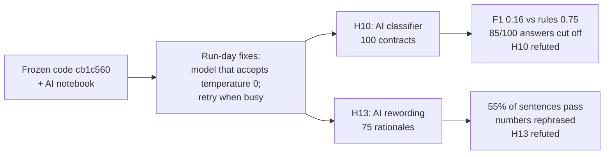

# Step 8: AI runs (H10, H13)

| | |
|---|---|
| Date | 2026-11-27 (run 14:05–14:52 UTC) |
| Code | frozen commit `cb1c56096ee50d6c6f8dcdfde077a5098e4c60c9` (tag `quantumclock-v1.0-frozen`) |
| Notebook | `notebooks/AI_runs_H10_H13.ipynb`; executed copy in `notebooks/runs/` |
| Model | chosen on the run day (D13); recorded only as `model-sha256:7d811269d13fd7df0fd2cb573cbd1b11679a1ae347c179b3daf22b12408604c4` |
| Status | done: **H10 refuted, H13 refuted** |

## Why

The last two pre-registered hypotheses test the AI parts of QAMP: can a knowledge-grounded AI classifier find
signature surfaces better than the rules (H10), and can an AI reword the system's explanations for auditors without
losing their grounding (H13)?

## What was done

1. Ran the notebook in Colab with the frozen code. The API key was typed into a hidden prompt and not saved.
2. **Two run-day problems, fixed without changing the frozen code** (recorded in PREREGISTRATION.md, D21–D22):
   - the newest balanced model rejected `temperature = 0`, which the frozen code asks for (repeatable answers). The
     run used the newest balanced model that accepts it, found with a tiny test call;
   - a network wrapper retries calls when the service is busy.
   Three earlier attempts failed before any model call (wrong key type; model name not found; the temperature
   setting) and cost nothing.
3. The notebook decided H10 and H13 with the rules written in section 2 of the pre-registration, replaced the model
   name with its fingerprint in every output, and saved the results.

## Outputs

| File | SHA-256 |
|---|---|
| `results/ai_runs/decisions.json` | `332955e618726f8d289e472630a57908659fc88ee5c9a558bd0f073ab98c0f59` |
| `results/discovery/discovery_llm.json` | `c44e9a2604c63b304e009a9c48b7ea80ef4a75821be325361e833fab31b4f03d` |
| `results/discovery/inventory_llm.json` | `e4652cdd46d6822c620d43cbbfa17f5b30a8494943fe3a0a14ec823ddb6d7982` |
| `results/discovery/cbom_llm.json` | `60e3de8103503d576ce3c34e57243e82d701fc4c4da0bd8d02a69aba6b7ea1a8` |
| `results/discovery/llm_log.jsonl` (every prompt and answer) | `0e809343fc3c9af0f3fbf30e9f0e6d55a09b01094a7eb2e37a082d87b7bc2045` |
| `results/explain/checks.json` | `9e8bc6c53b306786b6f83c18103bfd1c4e488dc4a17ce27ccce9656719a19496` |
| `results/explain/llm_log.jsonl` (every prompt and answer) | `a346794273f2bb67fe9c025d48ad876ce63e47eb27078f428fc2c83f685a0dcb` |

## Results

| | AI | Rules | Rule fixed in advance | Verdict |
|---|---|---|---|---|
| **H10** F1 (every token) | **0.156** | 0.750 | AI F1 > rules F1 | |
| H10 answers dropped | **59%** (85 of 144) | – | ≤ 5% | **REFUTED** |
| H10 precision / recall | 0.667 / 0.089 | 0.670 / 0.852 | – | |
| H10 invented citations | 0 | – | – | |
| **H13** reworded sentences that pass | **55.4%** (of 821) | template explanations: 100% (H12) | ≥ 95% | **REFUTED** |

## Why they failed (from the logs)

**H10: the answers were cut off, not wrong.** 85 of the 100 answers stop at about 5,000 characters, the 2,000-token
answer limit fixed in the frozen code, before the list closes, so they cannot be read and count as dropped. The AI
wrote long answers with careful notes (for example, naming the outside contracts that hold a role). Where answers were
complete (15 contracts), the AI was as precise as the rules (0.667 vs 0.670) and invented no citations. It also
separated library signature checks from direct ones better than the rules did (direct `ecrecover`: 5 found, 1 wrong;
rules: 5 found, 32 wrong). **The pre-registered verdict stands (refuted)**; the cause is reported as a limitation of
the instrument (answer length), which was fixed before the run and not changed.

**H13: citations were kept, numbers were rephrased.** Every content sentence the AI wrote kept a citation; the 40
lines without one were its opening line ("Here is the rationale rewritten…"). Sentences failed the faithfulness check
because the AI wrote values differently, for example "2027Q1" as "the first quarter of 2027" or "2" as "two". The
check requires the cited values to appear as given, so these sentences cannot be verified mechanically. This supports
QAMP's design choice: explanations built from templates and citations are fully verifiable (H12), free AI rewording is
not.

## Checks

| Check | Result |
|---|---|
| Frozen code used | yes (`cb1c560`, asserted by the notebook) |
| Decision rules as written in the pre-registration | yes |
| Model name or API key in any output | no (fingerprint only) |
| Every prompt and answer saved | yes (two `llm_log.jsonl` files) |

## Limits and deviations

1. **D21: model choice.** The newest balanced model rejected `temperature = 0`; the run used the newest balanced model
   that accepts it.
2. **D22: network wrapper.** Busy errors (429, 5xx, timeouts) were retried with waits. The frozen code was not changed.
3. **H10's answer limit** (2,000 tokens) was part of the frozen code. A run with a larger limit would be a new,
   exploratory experiment, not a test of H10.
4. **AI-made labels** (D8, D15): H10 is scored against labels made by an AI assistant.
