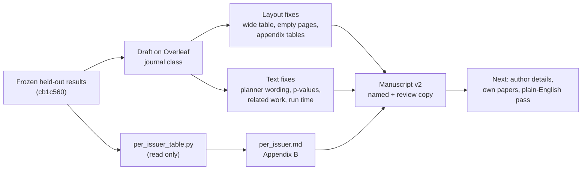

# Step 9: Manuscript for Expert Systems with Applications

| | |
|---|---|
| Date | 2026-11-28 |
| Code | unchanged; frozen commit `cb1c56096ee50d6c6f8dcdfde077a5098e4c60c9` (tag `quantumclock-v1.0-frozen`) |
| New files | `tools/per_issuer_table.py` (commit `c66c4f2`), `results/held_out/per_issuer.md` (commit `9477653`) |
| Status | in progress: draft compiles on Overleaf; author details, own papers and AI declaration still to fill |

## Why

The experiments are finished. This step writes them up for the journal. No code, data, result or hypothesis verdict
changes here. Every number in the paper is traced to a result file.

## What was done

1. Compiled the draft on Overleaf with the journal's own LaTeX class (named copy and anonymous review copy).
2. Fixed the layout: one table was wider than the page, some pages were half empty, and the appendix tables floated
   away from their headings.
3. Revised the text after a reviewer-style read:
   - the planner is now described correctly (one plan made from an average over 20,000 sampled scenarios; it does not
     adapt after the arrival date is known);
   - p-values on simulated scenarios are explained as simulation error only; results are judged by the size of the
     difference and its confidence interval;
   - related work on expert systems, explanations, rule + AI systems and replacement planning, 11 new references,
     each checked by web search;
   - problem size and run time, an example rule from the knowledge base, a worked example for one issuer, a
     threats-to-validity section, and a per-issuer appendix.
4. Added a small read-only script that lists the frozen held-out plans issuer by issuer (for the appendix).
   It reads `results/held_out/results.json` and writes `results/held_out/per_issuer.md`. It changes nothing else.

## Outputs

| File | SHA-256 |
|---|---|
| `tools/per_issuer_table.py` | `f07ad1756b05b5e51b5abfbd01ba09baa5cfba3a08b8a9d4a1b3a07ab1ef54a3` |
| `results/held_out/per_issuer.md` | `623ca6e3518f23d0a75ddffe68411b05314328d6967826d0f230bfc048eb76bf` |
| `results/held_out/results.json` (input, unchanged) | `4454df594cefb06f06546bbc54d73800cecdc03e7eed4995af2e2a5e57aca672` |

The manuscript files are kept outside this repository (Overleaf).

## What the per-issuer view shows

| | QAMP | ASAP |
|---|---|---|
| Migrations started in 2027 | 58 of 75 | 65 of 75 |
| Last start | 2034 Q2 (a small Apex key that is still hidden; takes effect 2034 Q4) | 2028 Q3 |

For the large issuers, QAMP and ASAP start migrations over similar spans. QAMP delays mainly the smallest issuers (Apex, WisdomTree, PinLink,
each under USD 10m at risk), where the falling migration cost outweighs a small expected loss.
All migrations still take effect before the 2035 deadline.

## Checks

| Check | Result |
|---|---|
| Script re-run on a fresh copy of the repository gives the same `per_issuer.md` | yes |
| Anchors 75, issuer groups 28, anchor values sum to USD 27.0bn (as in step 7) | yes |
| Named and review copies compile on Overleaf, no broken references | yes |
| Review copy has no name, no GitHub link, anonymous self-citations | yes |
| New references checked by web search | yes (11); two details left out because they could not be confirmed |

## What went differently from the plan

1. **Overleaf layout problems** (fixed): Table 4 was wider than the page; floats left half-empty pages; appendix
   tables printed after the references.
2. **"Two-stage" was the wrong word** for the planner (fixed in text and in Figure 2).
3. **Still open:** author details, the five earlier papers, the AI tool name in the declaration, the GRI 15-year range
   check, the archive DOI, and a plain-English pass over the more mathematical sections.
