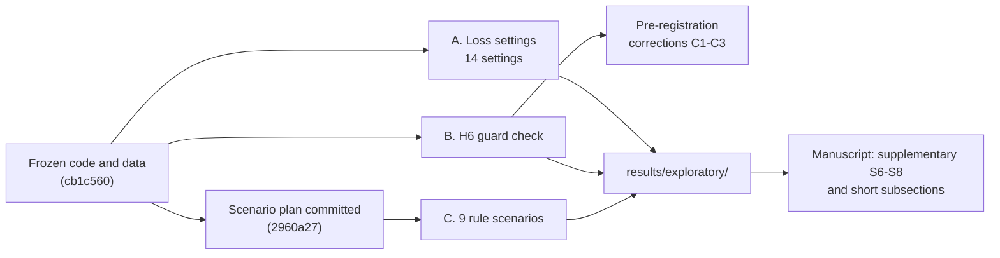

# Step 10: Checks after the held-out run (not pre-registered)

| | |
|---|---|
| Date | 2026-11-28 |
| Code | unchanged; frozen commit `cb1c56096ee50d6c6f8dcdfde077a5098e4c60c9` (tag `quantumclock-v1.0-frozen`) |
| Seeds | held-out (50,000), 20,000 planning and 2,000 evaluation scenarios, as in step 7 |
| Status | done |

## Why

Readers of the draft raised three questions the pre-registered run could not answer:

1. Do the cost results depend on the assumed loss settings?
2. Is the guard result (H6) measured fairly, and does the guard still work when bridged copies run late on their own?
3. Does the knowledge base really steer the plan, or only the explanations?

Each check below is labelled post hoc or post-registration. None changes code, data, a frozen result or a hypothesis
verdict. Wording errors found in the pre-registration are corrected in its section 8 (C1-C3), with nothing removed.

## What was done

| Check | Script | Run | Commits |
|---|---|---|---|
| A. Loss-setting sensitivity (exploratory) | `tools/loss_sensitivity.py` | Colab, `notebooks/loss_sensitivity.ipynb` | `cf379f4`, `25b9561`, `ce686b7`, `1a984c8`, `fd5459d` |
| B. H6 guard check (post hoc) | `tools/h6_check.py` | Colab, `notebooks/h6_check.ipynb` | `d2efd20`, `a52fc62`, `593a36a`, `963c0b7` |
| Pre-registration corrections C1-C3 | – | – | `0cb2695` |
| C. Knowledge-base scenarios (post-registration) | `tools/kb_scenarios.py`, rules in `kb_scenarios/` | Colab, `notebooks/kb_scenarios.ipynb` | plan `2960a27` (before the run), `f6a0cdc`, `ec5d470`, `d8e73a6`, `1464229`, `51567df` |

For check C the plan (`docs/KB_SCENARIOS_PLAN.md`) was committed before any scenario was run.

## Results

**A. Loss settings.** QAMP was cheaper than ASAP, greedy risk and Mosca in all 14 settings. ASAP minus QAMP ranged
from USD 19.8m (attack hazard 0.25 a year) to USD 64.7m (record value 0.05). With no record loss at all it was
USD 38.5m.

**B. H6 guard.** The frozen code compared expected loss with realised loss *plus spend* (47.0%). Measured like for
like, the underestimate is 23.7% (loss vs loss) or 16.4% (cost vs cost). Both still pass the 10% threshold, so the
verdict stands; the wording is corrected in C1-C3. The guarded plan gives bridged copies the same start quarter, but
when each copy can run late on its own, 5.54 of 13 components take effect in different quarters on average, and with
bridges open every scenario has a violation. With pause-and-revalidate there are none.

**C. Knowledge-base scenarios.** S0 reproduced the frozen QAMP cost (USD 369.6m). No code or rule changed during the
run (fingerprint and git check).

| Scenario | Starts changed | Expected misses | Cost vs S0 (USD m) |
|---|---|---|---|
| S1 deadline 2030, compliance-critical keys | 5 | 0 | +0.0 |
| S2 deadline 2032, compliance-critical keys | 4 | 0 | -0.0 |
| S3 deadline 2030, all keys | 6 | 0.29 | +0.1 |
| S4a/b/c EU only, US only, no retention rules | 0 | 0 | -2.0 / +0.0 / -10.8 (own rules) |
| S5 EU retention 10 years | 2 | 0 | +7.3 (own rules) |
| S6 S3 with capacity 1 per issuer | 31 | 3.9 | +357.6 |

## What worked

- Deadline rules steer the plan: each new deadline is respected, at almost no cost. Planning cost-first would miss
  2 (S1), 3 (S3) and 6.6 (S6) deadlines on average.
- When a deadline cannot be met (S6), the system names the issuer (Ondo: 22 slots needed, 16 available) and reports
  the misses instead of hiding them.
- Each conclusion is traced to the rule that decided it (for example S5: retention set by the scenario rule for 57
  anchors).

## What failed or is limited

- **Retention rules barely move the plan.** S4 changes no start; S5 changes 2. They change the measured cost, not the
  schedule. On the S0 yardstick every retention scenario costs the same as S0.
- **The explanation checks miss a wrong source name.** The template words every hard deadline as "disallowed ...
  under NIST IR 8547". In S2, 43 sentences name NIST for a rule taken from the G7 roadmap, yet validity and
  faithfulness both score 100%. In S1 and S3 a deprecation date treated as binding is worded as "disallowed". The
  template was not changed.
- **The guard is checked at planned durations.** It does not protect against copies that run late on their own;
  pause-and-revalidate does.

## Outputs

| File | SHA-256 |
|---|---|
| `tools/loss_sensitivity.py` | `540451f4041265d530e4ebc930741ac3501905f6875b363d7ad293c9b5da5d9b` |
| `results/exploratory/loss_sensitivity.json` | `b36223ec63f02ad38ba33acc72dfab696ac03799f634cc8cf61b562aaae46414` |
| `results/exploratory/loss_sensitivity.md` | `eb28ddf10f7dae66d3b08dec9fac20fe71b01fa7e7b3e5cc04eef7054ac867cb` |
| `tools/h6_check.py` | `bda45b36f69e797d620077cc7d76d7fe58c03e2e4323add6f226509c8504cc3b` |
| `results/exploratory/h6_check.json` | `63934f9a3951b974f3e54583a1ec3794eccdbb87804864e908b25b8a97ac4705` |
| `results/exploratory/h6_check.md` | `bae60154b2424d87637ea731c30c8d6a28de8e8f36d8576c6fc0e76b8f380bd0` |
| `docs/KB_SCENARIOS_PLAN.md` | `5e1ed6164dd6cc981dfad4a834c2371c2571f82c05ac64306e7e095c77358d0a` |
| `tools/kb_scenarios.py` | `c8864b78e811af5ded4ff239d5ca4a794f7ccabca4b0a1cca0aa5e234c02bebe` |
| `results/exploratory/kb_scenarios.json` | `1dd40e98ea6e04d3b3391beec91963fdaa41e45a686b77a1b86c60ae615a1b9a` |
| `results/exploratory/kb_scenarios.md` | `2d178064ca9ba73da39dfc8546da6a0aa6ee417e64ad2430fbdb369938a3f677` |
| `docs/PREREGISTRATION.md` (section 8 added) | `586c6fed6849cf67fca1ba65b5fed2cdac1d9a81934113941957be1fd572db7b` |

Screenshots and executed notebooks of each Colab run are in `notebooks/runs/`.

## Checks

| Check | Result |
|---|---|
| Each Colab result matches a run on a separate copy of the repository | yes (A, B, C) |
| Frozen numbers reproduced inside each check (QAMP USD 369.6m; H6 13 of 13 violations) | yes |
| `src/` and `kb/` unchanged (git and fingerprint) | yes |
| Scenario plan committed before the scenario run | yes (`2960a27`, before `f6a0cdc`) |
| Scenario rules use only sources already in the knowledge base | yes |

## What went differently from the plan

1. The H6 check found that the frozen code compared unlike quantities. The verdict holds at the corrected values;
   the wording was corrected in the pre-registration (C1-C3) rather than the result changed.
2. The scenario plan expected the explanation template to name the wrong source in S2. It did (43 sentences), and
   the checks did not catch it. This is reported as a limitation, not fixed.
