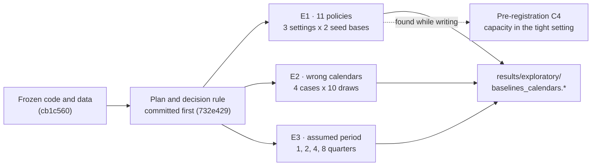

# Step 11: Stronger baselines and calendar robustness (post-registration)

| | |
|---|---|
| Date | 2026-11-28 |
| Code | unchanged; frozen commit `cb1c56096ee50d6c6f8dcdfde077a5098e4c60c9` (tag `quantumclock-v1.0-frozen`) |
| Seeds | held-out (50,000) and fresh (90,000, never used before); 20,000 planning and 2,000 evaluation scenarios |
| Status | done |

## Why

A reader of the draft asked whether QAMP wins because it sees the renewal calendars, which the six list
baselines do not, and whether the calendars can be trusted. Two facts made the question sharp:

1. QAMP planned without calendars ("no windows", USD 399.2m) cost about the same as greedy risk (USD 399.6m).
2. Of the 28 observed calendars, 26 renew every quarter (no window). The value of the windows rests mainly on the
   47 assumed annual calendars.

## What was done

The plan (`docs/BASELINES_CALENDARS_PLAN.md`) was committed before any run, with a decision rule: QAMP's optimiser
adds value over a calendar-aware heuristic only if the 95% interval lies above zero on both seed bases.

| Commit | What |
|---|---|
| `732e429` | Plan (before any run) |
| `f57a6f8` | Script `tools/baselines_calendars.py` (its commit message was reused from the plan by mistake; the file is the script) |
| `ab5e3c8` | Colab notebook |
| `0f6c6ce` | Screenshot and executed notebook (run on `ab5e3c8`) |
| `05fab84` | Results |
| `68f2534` | Pre-registration clarification C4 |

Five new baselines, all with the same information as QAMP (calendars, delays, capacity, durations, rules):
B1 calendar-aware greedy risk; B2 earliest last start first; B3 greedy on QAMP's own cost table (only the optimiser
differs); B4 and B5 QAMP's MILP planned for one arrival date (mean, median).

## Results

**E1, policy minus QAMP (USD m, 95% interval), held-out / fresh seeds.**

| Setting | Best calendar-aware baseline | Greedy risk (no calendars) | One date (median) |
|---|---|---|---|
| Main | B2: +21.1 (15.3 to 27.5) / +25.3 (19.8 to 31.9) | +30.0 / +31.9 | +3,621.5 / +3,766.7 |
| Every quarter | B3: +6.1 (4.2 to 8.0) / +4.3 (2.6 to 6.1) | +7.2 / +5.4 | +3,648.0 / +3,850.4 |
| Tight | B3: +9.8 (1.3 to 18.8) / +15.1 (7.1 to 23.1) | +114.1 / +124.8 | +2,717.3 / +2,857.5 |

S0 reproduced: QAMP USD 369.6m on the held-out seeds (370.5m on the fresh seeds).

**E2, wrong calendars** (plan on the frozen calendars, score on others for the 47 assumed anchors; mean of 10 draws):
QAMP minus greedy risk shrinks to USD 13.2m (annual, random phase), 4.8m (every 2 quarters), 4.4m (every quarter)
and 1.6m (every 8 quarters); in single draws greedy can win. QAMP planned on wrong calendars is about USD 3m worse than
QAMP planned with no calendars. B1-B3 lose more than QAMP.

**E3, assumed period** (planning and scoring): the window value (no windows minus QAMP) is about 0 at 1 or 2 quarters,
USD 29.5m at 4 and USD 19.9m at 8. At 8 quarters QAMP minus B3 is USD 5.7m (-2.8 to 14.4).

## What worked

- With the same information, the optimiser matters: the decision rule is met in all three E1 settings on both seed
  bases. Greedy on QAMP's own cost table (B3) costs USD 34.7m more in the main setting.
- Planning over many arrival dates is essential: planning for one date costs billions more and misses about 9.6
  deadlines.
- The fresh seeds agree with the held-out seeds.

## What failed or is limited

- **The window value depends on the assumed annual calendars.** With quarterly or two-quarterly calendars it is
  about zero.
- **Wrong calendars erode the advantage over simple greedy**, and planning on wrong calendars is slightly worse than
  planning without them.
- **Calendar-aware heuristics B1 and B2 did not beat plain greedy risk** in the main setting.
- **The decision rule fails once**: assumed 8-quarter calendars, QAMP vs B3 (held-out seeds only).
- **C4:** the frozen tight setting gave capacity 1 to 25 of 28 issuers; Backed (4), Ondo (4) and Re (2) kept their
  observed capacity. H11 stays confirmed for the setting as run.

## Outputs

| File | SHA-256 |
|---|---|
| `docs/BASELINES_CALENDARS_PLAN.md` | `6e33ed99a5c74af239aa4a79500aba1ba9a56ef56194567e48931df564fc9d10` |
| `tools/baselines_calendars.py` | `9c0842a6e5d8ba501a3f580f7c9ae07e03c913dc1ce2a2f1f2474867007a7625` |
| `results/exploratory/baselines_calendars.json` | `2fc47f26144f67fd42eedc6ec779e15d80eb628453dd5694743fc6a4d3f314f5` |
| `results/exploratory/baselines_calendars.md` | `4a11a06496257e493d3745271da20742f89cadbde8dbe4d0ce7ccd522399af2b` |
| `docs/PREREGISTRATION.md` (C4 added) | `c75f1e8548b3ff9f320568bb18635e2adea72bafbaa346b6292a9094b246394d` |

## Checks

| Check | Result |
|---|---|
| Plan committed before the script and the run | yes (`732e429`) |
| `src/` and `kb/` unchanged (fingerprint and git) | yes |
| Frozen numbers reproduced (QAMP 369.6, ASAP 409.2, no windows 399.2) | yes |
| Committed results match the downloaded files | yes |

## What went differently from the plan

1. The script's commit message repeats the plan's message (`f57a6f8`). The file content is the script.
2. The result files first failed to upload and were committed separately (`05fab84`), after the run evidence.
3. C4 was found while writing the script, not planned.
