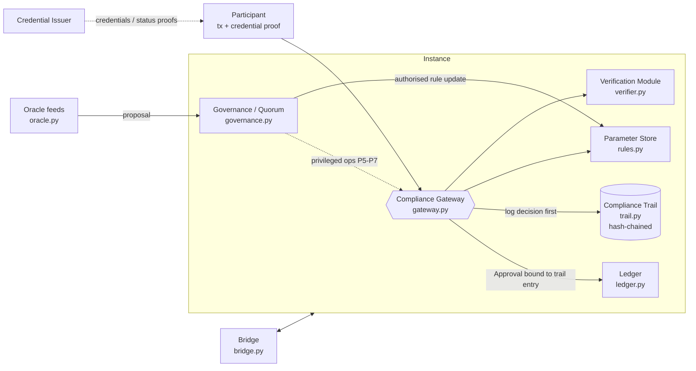

# Architecture

`rwa_threatlab` is a small, dependency-free Python implementation of the paper's reference architecture. One
`Instance` wires the five modules together; a `Bridge` joins two instances.

## The narrow waist

`Ledger.apply()` only moves balances when handed an `Approval` that the **current** Gateway issued for exactly that
transaction, that references an **accepted** Trail entry, and that has not been used before. A decision is therefore
logged before it can take effect, and approvals cannot be forged, replayed or moved to another transaction
(`tests/test_components.py::test_ledger_refuses_unapproved_and_forged_and_replayed_approvals`).

`Ledger.raw_move()` is the storage primitive. **Mediation** means no reachable entry point calls it without an
approval. The entry points are `Instance.transfer` (P1), `contract_transfer` (P2), `system_reward` (P3),
`inbound_mint` (P4), `forced_transfer` (P5), `upgrade_runtime` (P6) and `restore_snapshot` (P7); the build flags in
`Config` decide which of them are routed through the Gateway, and `Instance.mediation_report()` probes them
(an executable version of the paper's Table 1).

## Configurations

`Config.baseline()` is a naive build with implementation faults and no mitigations; `Config.hardened()` applies the
paper's mitigations M1-M15. Scenarios flip individual switches (`Config.replace`) to show what each mitigation buys.

| Mitigation | Switch(es) | Where |
|---|---|---|
| M1 complete mediation | `legacy_raw_path`, `p2_mediated`, `p3_mediated` | `system.py`, `ledger.py` |
| M2 gateway assurance | `defect_origin_spoof`; bounded `conformance_failures()` | `gateway.py`, `attacks.py` |
| M3 privileged operations | `priv_via_gateway`, `guarded_upgrade`, `upgrade_timelock` | `system.py` |
| M4 challenge period | `challenge_window` | `governance.py` |
| M5 asymmetric activation | `asymmetric_activation`, `tighten_expiry` | `governance.py` |
| M6 oracle hardening | `multi_source_k`, `auto_ingest_oracle`, `bulk_delist_threshold`, `provenance_independent_contestation` | `oracle.py`, `governance.py` |
| M7 issuer allow-list and scope | `allowlist`, `scoped_issuance` | `verifier.py` |
| M8 / M15 status freshness | `freshness_bound` | `verifier.py` |
| M9 batched submission | `epoch` argument of `timing_linkage` | `scenarios/privacy.py` |
| M10 rule-class logging, uniform errors | `log_granularity`, `uniform_errors` | `gateway.py` |
| M11 blind issuance | `Issuer(blind=True)` | `credentials.py` |
| M12 pending-change notice | `pending_flag` | `bridge.py` |
| M13 asset-bound profile | `profile_most_restrictive` | `gateway.py`, `bridge.py` |
| M14 destination mediation | `dest_mediation` | `system.py` |
